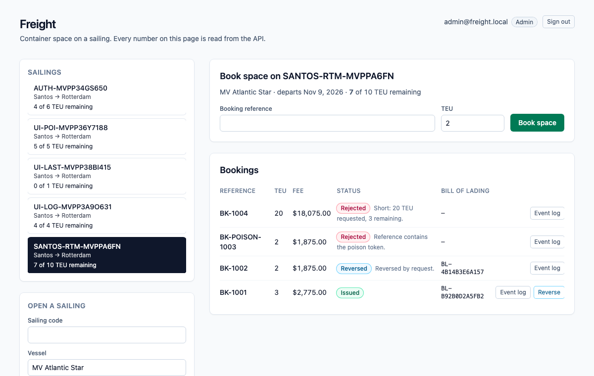
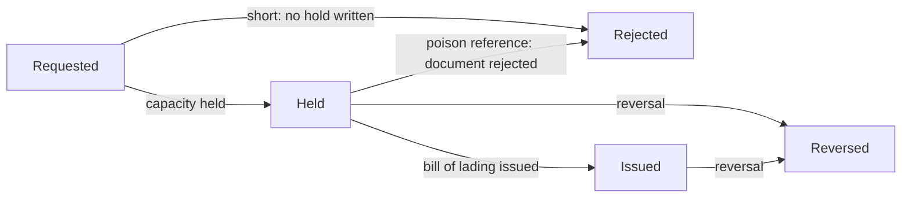
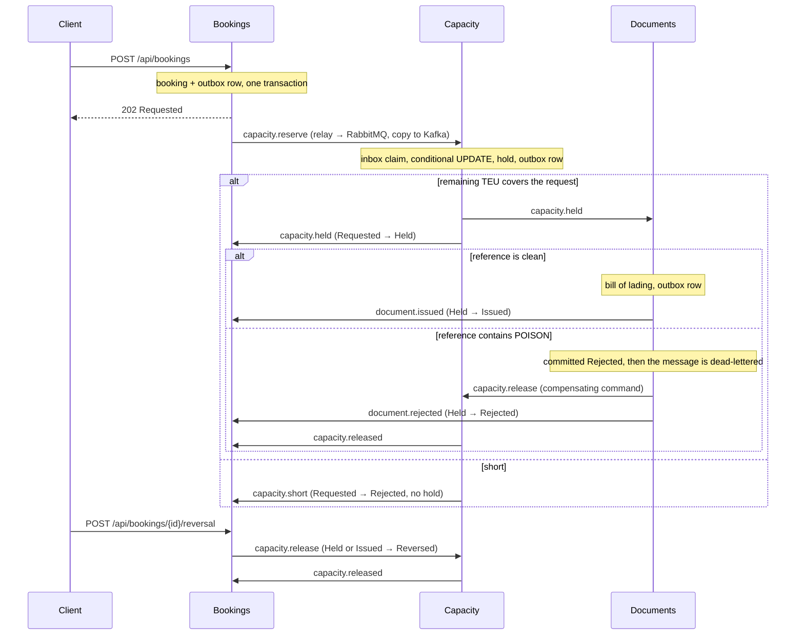

# dotnet-freight

Container space on a sailing. The scarce number is the **remaining TEU** of a sailing, and the **Capacity** module is its only writer: it holds space with a single conditional `UPDATE` that matches only while the remaining TEU still covers the request, so when two bookings fight for the last unit, one commits a hold and the other is short and writes none. A booking reference that contains the poison token `POISON` is committed as rejected by the Documents module, the message is dead-lettered, and a compensating command gives the TEU back. A later reversal also gives the TEU back, but it does not roll back the bill of lading that was already issued.

One ASP.NET Core process, one Postgres database. An HTTP write saves the booking and an outbox row in one local transaction; a `BackgroundService` relay publishes outbox rows to RabbitMQ (the work queue) and Kafka (the event log); the next module consumes from RabbitMQ, claims an inbox key in the same transaction as its own write, and writes its own row and outbox row. Saga steps never call each other in-process. Delivery is at-least-once: the relay can publish and crash before it marks a row sent, so the row goes out again, and every consumer dedupes with its inbox key. Each saga step only moves a booking forward from the status it expects.

> The Compose network is local and unauthenticated. There is no login, no token and no cookie. Do not publish these ports; Compose binds all of them to `127.0.0.1`.



*The UI reads everything from the API. Shown: one booking issued, one short, one rejected for the poison token, and one reversal that gave the TEU back and kept its bill of lading.*

## Booking statuses



`Reversed` and `Rejected` give the TEU back through a `ReleaseCapacity` command, and Capacity releases a hold at most once. The bill of lading has its own status (`Issued` or `Rejected`) and a reversal never changes it. If the reversal gets there before the final mark, the late mark finds the booking is no longer `Held` and does nothing.

## How the modules talk



| Module | Owns | Consumes | Emits |
| --- | --- | --- | --- |
| **Bookings** (`Modules/Bookings`) | `Bookings`: status, fee, reference. Validation, the poison rule, the fee. | `capacity.held`, `capacity.short`, `document.issued`, `document.rejected`, `capacity.released` | `capacity.reserve`, `capacity.release` (reversal) |
| **Capacity** (`Modules/Capacity`) | `Sailings.RemainingTeu` (sole writer after the sailing opens) and `CapacityHolds`. | `capacity.reserve`, `capacity.release` (prefetch 1) | `capacity.held`, `capacity.short`, `capacity.released` |
| **Documents** (`Modules/Documents`) | `BillsOfLading`. | `capacity.held` | `document.issued`, `document.rejected`, `capacity.release` (poison) |
| **Messaging** (`Messaging`) | `OutboxMessages`, `InboxMessages`, the relay, the consumer loop with retry and dead-letter, the Kafka log. | | |

RabbitMQ topology is declared in code (`Messaging/Topology.cs`): exchange `freight.work`, one queue per module (`capacity.commands`, `documents.work`, `bookings.events`), a `.retry` queue per module (2 s TTL, then back to the main queue, 3 attempts), and a `.dlq` per module behind `freight.dlx`. A transient failure retries; a poison message goes straight to the dead-letter queue after its rejection is committed. Kafka has one topic, `freight.events`, one partition, replication factor 1, keyed by booking id.

## Run it

Needs Node 22 (npm 10), .NET SDK 10.0.401 (`global.json`), Docker (arm64 is fine) and python3 for the smoke script.

```bash
npm ci
docker compose up -d --wait db        # dotnet test uses Postgres on 5470 (database freight_test)
dotnet test tests/api/Freight.Api.Tests.csproj
docker compose up --build --wait      # db, kafka, rabbitmq, api, web
./scripts/smoke.sh                    # last line: freight smoke passed
npx playwright install chromium       # once
npx playwright test                   # one spec against http://127.0.0.1:8090
docker compose down                   # keeps the Postgres volume; `down -v` drops it
```

| Service | Host port |
| --- | --- |
| Web (nginx, proxies `/api/`) | 8090 |
| API (`/scalar/v1`, `/api/health`) | 5210 |
| Postgres 17 | 5470 |
| Kafka 3.8.1 (KRaft, one broker) | 9120 |
| RabbitMQ 3.13 / management UI (`platform` / `platform`) | 5700 / 15700 |

Inside the Compose network the API and nginx listen on 8080 and Kafka's internal listener is 9092.

## Try it with curl

```bash
curl -s -X POST http://127.0.0.1:5210/api/sailings \
  -H 'content-type: application/json' \
  -d '{"code":"SANTOS-RTM-1","vessel":"MV Atlantic Star","origin":"Santos","destination":"Rotterdam","capacityTeu":10}'

curl -s -X POST http://127.0.0.1:5210/api/bookings \
  -H 'content-type: application/json' \
  -d '{"sailingCode":"SANTOS-RTM-1","reference":"BK-1001","teu":3}'
# 202, status Requested. Use the returned id:

curl -s http://127.0.0.1:5210/api/bookings/<id>             # Issued after a few seconds, with a bill of lading number
curl -s http://127.0.0.1:5210/api/documents/<id>
curl -s http://127.0.0.1:5210/api/sailings/SANTOS-RTM-1     # remainingTeu 7
curl -s http://127.0.0.1:5210/api/bookings/<id>/events      # the Kafka log for this booking

curl -s -X POST http://127.0.0.1:5210/api/bookings/<id>/reversal \
  -H 'content-type: application/json'                       # TEU comes back; the bill of lading stays
```

A booking is validated at the door: reference required (at most 40 characters), TEU from 1 to 20. The fee is 90,000 cents per TEU plus a 7,500 cent documentation fee. The poison match is a case-sensitive substring: `BK-POISON-7` and any longer token containing `POISON` match.

## What is tested, and where it runs

- **xUnit against real Postgres** (`tests/api`, 25 tests): two tasks with two `DbContext`s fight for one remaining unit (one `Held`, one `Short`, remaining 0, no hold for the loser); empty input, over-limit input, integer overflow (4294967297 must not wrap to 1), the fee, the poison substring; the same message delivered twice is claimed once; a release returns the unit once; the poison rejection is committed before the dead-letter; a reversal followed by the late final mark leaves the booking `Reversed` and the document `Issued`. The race test was run against a read-then-write version of the reservation, where it failed, and against the conditional update, where it passes.
- **`scripts/smoke.sh`** drives the composed stack with a run id on every code, so a kept volume does not collide: validation, the happy path (fee, bill of lading, Kafka log), the last unit with three concurrent bookings (one issued, two short, no hold for the losers), the poison reference (rejected, `documents.work.dlq` gains one message, TEU restored), and a reversal that lands between the bill of lading and the final mark (booking `Reversed`, document `Issued`, TEU back, second reversal `409`). To make that last window wide enough to hit on purpose, Compose sets `Bookings__FinalMarkDelayMs=1500`; it is a latency knob and defaults to 0.
- **Playwright** (`e2e/specs/book-space.spec.ts`): opens a sailing in the UI, books space, sees `Issued` and the bill of lading number, reloads to prove the page reads the API and keeps nothing in `localStorage`, then reverses and sees the TEU come back. It runs against the composed web port, on a developer machine.
- **CI** (`.github/workflows/ci.yml`, on push): `npm ci`, Prettier check, `dotnet format whitespace --verify-no-changes`, `dotnet test` with a Postgres 17 service, and `nx build` for web and api. CI does not run the compose smoke or the Playwright spec.

## Cloud mapping

This repository runs on Compose. Nothing in it calls a cloud account.

| Here | On AWS |
| --- | --- |
| Postgres 17 | RDS for PostgreSQL |
| Kafka 3.8 | MSK |
| RabbitMQ 3.13 | Amazon MQ, or SQS with a dead-letter queue |
| The API and the web app | ECS or App Service |

## API

All routes are unauthenticated JSON. Interactive docs are at `http://127.0.0.1:5210/scalar/v1` (OpenAPI at `/openapi/v1.json`); the web port proxies `/api/`, `/scalar/` and `/openapi/` too.

| Method and path | What it does | Responses |
| --- | --- | --- |
| `GET /api/health` | Liveness. | `200 Healthy` |
| `POST /api/sailings` | Opens a sailing with its starting count. | `201`, `400` invalid, `409` code exists |
| `GET /api/sailings` | Lists sailings. | `200` |
| `GET /api/sailings/{code}` | One sailing with the live remaining count. | `200`, `404` |
| `POST /api/bookings` | Accepts a booking (1 to 20 TEU) and starts the saga. | `202` Requested, `400` invalid, `404` unknown sailing, `409` duplicate reference |
| `GET /api/bookings?sailingCode=` | Lists the latest 100 bookings, optionally for one sailing. | `200` |
| `GET /api/bookings/{id}` | One booking and its status. | `200`, `404` |
| `POST /api/bookings/{id}/reversal` | Moves a held or issued booking to its reversal status and gives the TEU back. The bill of lading is not touched. | `202`, `404`, `409` wrong status |
| `GET /api/bookings/{id}/events` | The Kafka event log for one booking, read from the start of the topic. | `200` |
| `GET /api/documents/{bookingId}` | The bill of lading row. | `200`, `404` until the step has run |

Errors come back as `application/problem+json` with a `title`.

## Configuration

Compose sets these on the API container. Defaults in `apps/api/appsettings.json` point at the published host ports, so `nx serve api` works against `docker compose up -d --wait db kafka rabbitmq`.

| Setting | Compose value | Meaning |
| --- | --- | --- |
| `ConnectionStrings__Freight` | `Host=db;Port=5432;Database=freight;Username=freight;Password=freight` | The one Postgres database. Migrations run on startup. |
| `RabbitMq__Host` / `__Port` / `__User` / `__Password` | `rabbitmq` / `5672` / `platform` / `platform` | Work queue. Virtual host `/`. |
| `Kafka__BootstrapServers` | `kafka:9092` | Event log. |
| `Bookings__FinalMarkDelayMs` | `1500` | Milliseconds the final mark waits. A latency knob so the smoke can land a reversal inside the window. `0` outside Compose. |
| `FREIGHT_TEST_DB` (tests only) | | Postgres connection for `dotnet test`. Defaults to `localhost:5470`, database `freight_test`. CI points it at its service container. |

## Look inside and fix things

```bash
docker compose ps                      # five services, all healthy
docker compose logs -f api             # relay, consumers, poison and retry lines
docker compose exec db psql -U freight -d freight -c 'select "RoutingKey","SentAt" from "OutboxMessages" order by "Id" desc limit 10'
open http://127.0.0.1:15700        # RabbitMQ management, platform / platform
```

- **Dead-lettered messages** sit in `documents.work.dlq`. Nothing replays them; inspect them in the management UI. Retries wait in `<queue>.retry` for 2 seconds.
- **A port is already in use**: `lsof -nP -i :5210` shows who holds it. Compose publishes only on `127.0.0.1`.
- **`dotnet test` cannot connect**: start Postgres first with `docker compose up -d --wait db`.
- **The smoke cannot reach the API**: run `docker compose up --build --wait` first; override the target with `API=... RABBIT=... ./scripts/smoke.sh`.
- **Start clean**: `docker compose down -v` drops Postgres, Kafka and RabbitMQ data. Plain `down` keeps them, and the smoke is safe on kept data because every code carries a run id.
- **The Kafka log looks empty right after a booking**: the relay publishes within a second or so; reload the event log.

## Known limits

- It is unauthenticated on purpose. Anything that can reach the API can read and write everything.
- Delivery is at-least-once, not exactly-once. The inbox makes repeats harmless for the saga; the Kafka log can hold a duplicate event after a relay crash.
- One broker, one partition, replication factor 1, one API instance. The relay does not coordinate across instances (the inbox would absorb the duplicates, but the outbox is never trimmed).
- `GET .../events` scans the whole topic for each call. Fine here, not something to expose at scale.
- Lists are capped at 100 rows and not paginated.
- Dead-lettered messages are not replayed automatically.
- The browser spec and the compose smoke run on a developer machine; CI does not run them.

## Layout

```
apps/api      ASP.NET Core monolith: Modules/{Bookings,Capacity,Documents}, Messaging, Data, Migrations
apps/web      Angular 21, styled with Tailwind 4 utilities only
tests/api     xUnit against Postgres
e2e/          Playwright
scripts/      smoke.sh
compose.yaml  Postgres, Kafka, RabbitMQ, API, web
```

Nx 23.2.1 orchestrates `nx build web` and `nx build api`; EF Core migrations are committed and the API applies them on startup.

## Other systems in this .NET track

- [dotnet-clinic](https://github.com/joshbarros/dotnet-clinic): appointment slots in a provider session.
- [dotnet-ledger](https://github.com/joshbarros/dotnet-ledger): outgoing payments from an account balance.
- [dotnet-warehouse](https://github.com/joshbarros/dotnet-warehouse): warehouse stock and outbound orders.
- [dotnet-academy](https://github.com/joshbarros/dotnet-academy): course cohort seats and enrollments.
